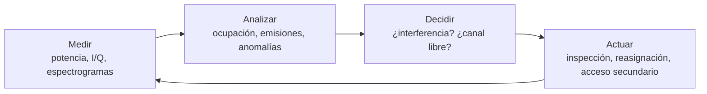

# Parte 1 de 6 — Samy: Fundamentos del monitoreo y la gestión del espectro radioeléctrico

**Tema general:** Monitoreo y gestión del espectro radioeléctrico mediante *Machine Learning*: detección de interferencias e identificación de espacios en blanco.  
**Responsable:** Samy  
**Tipo de trabajo:** Estado del arte. Fundamentos, contexto del problema y bases teóricas.  
**Enfoque:** explicar los conceptos de los que parten las demás secciones sin profundizar en los algoritmos. La detección de interferencias se desarrolla en la Parte 2 (Daniela), los espacios en blanco en la Parte 3 (Fabián), los datos en la Parte 4 (Kendry), el procesamiento y los algoritmos en la Parte 5 (Diego) y la evaluación en la Parte 6 (Rubén).

## 1.1. Introducción y objetivo

Casi todas las tecnologías inalámbricas que se usan hoy (radio y televisión, telefonía móvil, Wi-Fi, Bluetooth, GPS, radares, enlaces satelitales, redes de sensores IoT) transmiten a través del mismo medio: el espectro radioeléctrico. Como hay cada vez más servicios y dispositivos, ese recurso tiene que organizarse para que todos funcionen sin estorbarse unos a otros. De esa organización se ocupan la **gestión** y el **monitoreo** del espectro.

Esta sección busca responder cuatro preguntas:

1. ¿Qué problemas intenta resolver el monitoreo del espectro?
2. ¿Por qué es importante detectar interferencias e identificar espacios en blanco?
3. ¿Qué aporta Machine Learning a este campo?
4. ¿Qué relación existe entre la detección de interferencias y la identificación de espacios en blanco?

Para responderlas primero se definen los conceptos básicos (espectro, gestión, monitoreo, ocupación, interferencia, espacio en blanco, radio cognitiva y acceso dinámico). Después se revisan las limitaciones de los métodos tradicionales y, a partir de ellas, se explica por qué se aplica Machine Learning.

## 1.2. ¿Qué es el espectro radioeléctrico?

El Reglamento de Radiocomunicaciones de la Unión Internacional de Telecomunicaciones (UIT) define las **ondas radioeléctricas** como ondas electromagnéticas de frecuencia arbitrariamente inferior a 3000 GHz que se propagan por el espacio sin guía artificial [1]. El **espectro radioeléctrico** es el conjunto de esas frecuencias, es decir, la parte del espectro electromagnético que se usa para radiocomunicaciones.

El espectro se considera un **recurso natural limitado**. No se gasta al usarlo, pero dos sistemas no pueden transmitir en la misma frecuencia, en el mismo lugar y al mismo tiempo sin que uno degrade al otro. Por eso suele describirse con tres dimensiones: **frecuencia, tiempo y espacio**. A veces se agregan otras, como la dirección de la antena o el código, cuando la técnica de transmisión permite separar usuarios de esa forma.

Las propiedades físicas de la propagación cambian mucho con la frecuencia, así que cada banda resulta adecuada para servicios distintos:

| Banda | Rango | Ejemplos de uso | Relación con el proyecto |
|---|---|---|---|
| VHF | 30–300 MHz | Radio FM, radio móvil terrestre, comunicaciones aeronáuticas | Bandas incluidas en barridos de ocupación de banda ancha (p. ej. AERPAW, Parte 4) |
| UHF | 300 MHz–3 GHz | Televisión digital, telefonía móvil (GSM, LTE), GNSS (~1,2–1,6 GHz), ISM 868/915 MHz, Wi-Fi y Bluetooth en 2,4 GHz | TV White Spaces, LOG-a-TEC (868 MHz), interferencias en GNSS |
| SHF | 3–30 GHz | 5G (~3,3–3,8 GHz), Wi-Fi 5 GHz, radar, enlaces satelitales y de microondas | Banda compartida CBRS (3,55–3,7 GHz) y datos NIST (Parte 4) |

Las frecuencias bajas llegan más lejos y atraviesan mejor los obstáculos, pero ofrecen menos ancho de banda. Por eso las bandas más demandadas, y donde más conflictos de uso hay, están entre unos cientos de MHz y unos pocos GHz.

## 1.3. ¿Qué significa gestionar y monitorear el espectro?

### 1.3.1. Gestión del espectro

La **gestión del espectro** reúne los procedimientos administrativos y técnicos con los que se decide quién puede usar qué frecuencias, dónde, cuándo y bajo qué condiciones. El Reglamento de Radiocomunicaciones distingue tres niveles [1]:

- **Atribución:** se reserva una banda para uno o varios *servicios* (por ejemplo, móvil, radiodifusión o radionavegación). Lo decide la UIT en el Cuadro de atribución de bandas de frecuencias, que diferencia tres Regiones del mundo (América es la Región 2).
- **Adjudicación:** se reparte un canal de una banda atribuida entre países o zonas geográficas.
- **Asignación:** la administración nacional autoriza a una *estación* concreta a usar una frecuencia con ciertos parámetros (potencia, ancho de banda, ubicación).

El modelo tradicional, conocido como *command and control*, asigna licencias **exclusivas y estáticas**. Cada banda pertenece a un servicio o a un operador, aunque este no la use todo el tiempo ni en todas partes. Este modelo protege bien contra interferencias, pero, como se verá en la sección 1.4, desperdicia mucho espectro.

### 1.3.2. Monitoreo del espectro

El **monitoreo del espectro**, que en la terminología de la UIT se llama *comprobación técnica de las emisiones*, es la parte de la gestión que **observa cómo se usa realmente el espectro**. Según el *Handbook on Spectrum Monitoring* de la UIT [2], sus objetivos principales son:

- Comprobar que las estaciones autorizadas respetan sus parámetros técnicos (frecuencia, ancho de banda, potencia, emisiones no deseadas).
- **Detectar e investigar interferencias**, y responder a las quejas de los usuarios afectados.
- **Medir la ocupación del espectro** para saber qué bandas están saturadas y cuáles están subutilizadas.
- Identificar y localizar transmisores no autorizados.
- Aportar datos reales a la planificación y a las decisiones regulatorias, como reasignar bandas o permitir el uso compartido.

Para hacerlo se usan analizadores de espectro y receptores de medida, equipos de radiogoniometría para localizar emisores y, cada vez más, **radios definidas por software (SDR)** y **redes distribuidas de sensores** de bajo coste. Un ejemplo de estas últimas es Electrosense, una red colaborativa que recoge datos de espectro de muchos sensores repartidos geográficamente [3].

El monitoreo funciona como un ciclo continuo:

El proyecto se ubica en la etapa de **análisis**: transformar mediciones en decisiones útiles, en particular *«hay una interferencia»* y *«este canal está libre»*.

## 1.4. ¿Qué es la ocupación espectral?

La **ocupación espectral** mide cuánto se usa una frecuencia o una banda. La Recomendación UIT-R SM.1880 [4] la define a partir de mediciones repetidas: un canal se considera **ocupado** en un instante si el nivel medido supera un umbral, y la ocupación es la **fracción de tiempo** en que eso ocurre. Si se agrega por frecuencia, se obtiene la ocupación de la banda completa. Expresado de forma simple:

$$
O = \frac{1}{N}\sum_{i=1}^{N} \mathbb{1}\left[P_i > \lambda\right]
$$

donde $P_i$ es la potencia medida en la observación $i$, $\lambda$ es el umbral (normalmente unos dB por encima del piso de ruido) y $N$ es el número de observaciones.

Esta definición tiene dos consecuencias importantes para el proyecto:

1. **La ocupación depende de cómo se mide.** El umbral, la sensibilidad del receptor, el ancho de banda de resolución, la duración de la medida y el lugar del sensor cambian el resultado. Una señal débil por debajo del umbral cuenta como «libre». Kendry discute esto en detalle en la Parte 4 (secciones 4.2 y 4.6).
2. **La ocupación es una etiqueta operativa, no una verdad absoluta.** Cuando un dataset trae etiquetas ocupado/libre calculadas con un umbral, el modelo de ML aprende ese criterio junto con sus errores.

### La paradoja de la escasez

Las mediciones de ocupación muestran algo llamativo: **el espectro parece escaso porque está asignado, pero en la práctica se usa poco**. El grupo de trabajo de política de espectro de la FCC de Estados Unidos concluyó en 2002 que el problema principal en muchas bandas es el **acceso** al espectro y no su escasez física [5]. Según la FCC, citada por Akyildiz et al. [6], la utilización del espectro asignado varía entre un **15 % y un 85 %** según el lugar y el momento. Las campañas de medición de McHenry et al. en Chicago y Nueva York, entre 30 MHz y 3 GHz, encontraron ocupaciones medias de apenas un **17 % y un 13 %**, respectivamente [7].

Esta paradoja es el punto de partida de la radio cognitiva y del acceso dinámico al espectro: si gran parte del espectro asignado está libre gran parte del tiempo, ese espacio podría aprovecharse **siempre que no se interfiera a quien tiene la licencia**.

## 1.5. ¿Qué son las interferencias?

El Reglamento de Radiocomunicaciones distingue dos conceptos [1]:

- **Interferencia:** el efecto de una energía no deseada, debida a emisiones, radiaciones o inducciones, sobre la recepción en un sistema de radiocomunicación. Se manifiesta como degradación de la calidad, falsa interpretación o pérdida de información que se habría podido obtener sin esa energía.
- **Interferencia perjudicial:** la que compromete el funcionamiento de un servicio de radionavegación o de otros servicios de seguridad, o la que degrada gravemente, obstruye o interrumpe repetidamente un servicio de radiocomunicación que opera conforme al Reglamento.

Lo importante es que una interferencia **se define por su efecto sobre un receptor** y no por la sola presencia de otra señal. Como advierte Kendry en la Parte 4, que dos señales coincidan en el espectro **no implica necesariamente** que haya una interferencia perjudicial.

### Tipos de interferencia

Las interferencias suelen clasificarse según su origen y según su forma en el espectro:

| Criterio | Tipos | Ejemplos |
|---|---|---|
| **Intencionalidad** | Intencional (*jamming*) | Inhibidores de GNSS o de telefonía móvil, ataques de denegación de servicio en la capa física |
| | No intencional | Equipos defectuosos o mal configurados, emisiones fuera de banda, ruido industrial, transmisores sin licencia |
| **Relación en frecuencia** | Co-canal | Dos transmisores en la misma frecuencia con cobertura solapada |
| | Canal adyacente | Fugas de potencia de un canal vecino por filtrado insuficiente |
| | Intermodulación y armónicos | Productos no lineales que caen en otra banda |
| **Forma de la señal** | Tono o portadora continua, ruido de banda ancha, pulsos, barridos (*chirp*), saltos de frecuencia | Son, por ejemplo, las clases del dataset Fraunhofer GNSS de la Parte 4 |

Las consecuencias van desde una caída de la relación señal a interferencia más ruido (SINR) y más errores de bit, hasta la pérdida total del servicio. Cuando el servicio afectado es de seguridad, como la navegación aérea o el posicionamiento GNSS, una interferencia puede tener consecuencias graves. Por eso detectarlas e identificarlas rápido es una de las funciones centrales del monitoreo.

Visto como problema técnico, **detectar una interferencia** es decidir si lo que se observa en una banda se aparta de lo esperado (la señal de interés más ruido). A veces también hay que **clasificar** qué tipo de interferencia es. Daniela desarrolla este problema en la Parte 2.

## 1.6. ¿Qué son los espacios en blanco?

Haykin [8] define un **espacio en blanco** o **hueco espectral** (*spectrum hole*) como una banda de frecuencias asignada a un usuario primario que, **en un momento y un lugar determinados**, ese usuario no está utilizando. Un espacio en blanco no es una propiedad fija de una frecuencia: depende a la vez del tiempo, la frecuencia y el espacio (Parte 3, sección 1).

Haykin también propone clasificar el espectro según el nivel de potencia que se observa [8]:

- **Espacios negros:** ocupados por señales locales de alta potencia (a veces, interferencias).
- **Espacios grises:** ocupados parcialmente por señales de baja potencia.
- **Espacios blancos:** libres de señales de radiofrecuencia, salvo el ruido ambiental (térmico, impulsivo, etc.).

Esta clasificación muestra que **interferencia y espacio en blanco son extremos de la misma escala**. La relación se analiza en la sección 1.10.

Ya hay ejemplos regulatorios de aprovechamiento de espacios en blanco:

- **TV White Spaces:** la FCC y luego otros reguladores permitieron que dispositivos sin licencia usaran canales de televisión libres, consultando bases de datos geolocalizadas. El estándar IEEE 802.22 (redes regionales inalámbricas, WRAN) se diseñó para este caso [6].
- **CBRS (3,55–3,7 GHz) en Estados Unidos:** banda compartida en tres niveles (usuarios incumbentes, licencias de prioridad y acceso general), coordinada por un *Spectrum Access System* que se apoya en sensores de ambiente. Los datos NIST de la Parte 4 corresponden a esta banda.

La detección y la predicción de espacios en blanco con ML se tratan en la Parte 3 (Fabián).

## 1.7. Radio cognitiva y acceso dinámico al espectro

### 1.7.1. Radio cognitiva

El término **radio cognitiva** (*cognitive radio*) lo introdujeron Mitola y Maguire en 1999 [9] para describir radios definidas por software que **perciben su entorno, razonan y adaptan su comportamiento**. Haykin [8] lo formalizó como un sistema inalámbrico inteligente que:

1. es consciente de su entorno,
2. **aprende de él** («comprensión mediante construcción»), y
3. adapta sus parámetros de operación (frecuencia, potencia, modulación) en tiempo real,

con dos objetivos: comunicaciones fiables en cualquier momento y lugar, y un uso eficiente del espectro.

Haykin describe un **ciclo cognitivo** con tres tareas básicas [8]: (a) **análisis del entorno radioeléctrico**, que incluye estimar la interferencia y detectar huecos espectrales; (b) **estimación del estado del canal** y predicción de su capacidad; y (c) **control de potencia y gestión dinámica del espectro**. La tarea (a) corresponde exactamente a los dos problemas de este proyecto.

En la radio cognitiva hay dos tipos de usuario:

- **Usuario primario (PU):** tiene la licencia de la banda y tiene prioridad. No debe sufrir interferencia perjudicial.
- **Usuario secundario (SU):** no tiene licencia, o tiene una de menor prioridad, y aprovecha el espectro **sin perjudicar** al primario.

Akyildiz et al. [6] resumen las funciones de una red de radio cognitiva en cuatro: **sensado** (detectar huecos), **decisión** (elegir el mejor canal), **compartición** (coordinar el acceso con otros usuarios) y **movilidad** (abandonar el canal cuando vuelve el primario).

### 1.7.2. Acceso dinámico al espectro

El **acceso dinámico al espectro** (*Dynamic Spectrum Access*, DSA) agrupa las alternativas al modelo de licencias estáticas. Zhao y Sadler [10] distinguen tres modelos:

| Modelo | Idea | Ejemplo |
|---|---|---|
| **Uso exclusivo dinámico** | Las licencias siguen siendo exclusivas, pero se pueden comerciar o reasignar con más flexibilidad | Mercados secundarios de espectro |
| **Compartición abierta** (*commons*) | Todos los usuarios tienen los mismos derechos | Bandas ISM (Wi-Fi, Bluetooth) |
| **Acceso jerárquico** | Usuarios secundarios acceden sin perjudicar a los primarios | Radio cognitiva |

Dentro del acceso jerárquico hay dos variantes:

- **Underlay (subyacente):** el secundario transmite al mismo tiempo que el primario, pero con potencia muy baja para no superar un límite de interferencia. La FCC propuso en 2003 la «temperatura de interferencia» como métrica para este enfoque, aunque la abandonó en 2007 [8].
- **Overlay u oportunista:** el secundario transmite **solo en los espacios en blanco** y debe dejar el canal en cuanto vuelve el primario. Este enfoque necesita **detectar** los huecos con fiabilidad y, si es posible, **predecir** cuánto durarán.

En los dos casos la condición es la misma: **aprovechar el espectro libre sin generar interferencia perjudicial**. Por eso los dos problemas del proyecto aparecen juntos.

## 1.8. Limitaciones de los métodos tradicionales de monitoreo

Los métodos clásicos de sensado se describen en la Parte 3 (sección 2). Aquí se resumen sus **limitaciones**, que son las que justifican buscar alternativas basadas en datos.

| Método o práctica | Supuesto | Limitación principal |
|---|---|---|
| **Detección de energía** con umbral [11] | Se conoce bien la potencia del ruido | Con incertidumbre en el ruido existe un **«muro de SNR»**: por debajo de cierta SNR no se puede detectar de forma fiable por mucho tiempo que se mida [12]. Además, no distingue *qué* señal está presente (primario, secundario o interferencia) |
| **Filtro adaptado** | Se conoce la forma de onda del primario | No sirve para señales desconocidas ni para interferencias arbitrarias, y necesita sincronización |
| **Detección cicloestacionaria** | La señal tiene periodicidades propias | Es costosa de calcular y requiere conocer las frecuencias cíclicas |
| **Sensado de un solo nodo** | El sensor ve lo mismo que el receptor primario | Desvanecimiento, sombra y **terminal oculto**: un nodo puede no ver al primario aunque esté activo [13] |
| **Bases de datos geolocalizadas** | Lo registrado coincide con lo que se usa | Informan del uso *autorizado*, no del uso *real*. No ven transmisores ilegales ni interferencias |
| **Barridos con analizador de espectro** | La señal dura lo suficiente para ser capturada | El barrido tarda en recorrer la banda y pierde ráfagas cortas. Captura poca información de cada emisión |
| **Análisis manual por expertos** | Un técnico revisa los registros | No escala: una semana de tres sensores de AERPAW ya ocupa **52 GB** (Parte 4). Es lento y depende de la experiencia de cada analista |
| **Reglas y umbrales fijos** | El entorno es estacionario | La ocupación cambia con la hora, el día y el lugar, y aparecen tecnologías nuevas. Los umbrales fijos se desajustan |

En conjunto, los métodos tradicionales **dependen de supuestos y conocimiento previo** (nivel de ruido, forma de onda, registros actualizados) que en la práctica no siempre se cumplen, y **no escalan** al volumen de datos que generan las redes modernas de sensores.

## 1.9. ¿Por qué se utiliza Machine Learning?

Machine Learning permite **cambiar reglas diseñadas a mano por modelos que aprenden de los datos**. Los dos problemas del proyecto se pueden formular como tareas estándar de aprendizaje:

| Problema | Formulación en ML | Tipo de aprendizaje | Salida | Se desarrolla en |
|---|---|---|---|---|
| ¿Está libre este canal ahora? | Clasificación binaria | Supervisado | Libre / ocupado | Parte 3 |
| ¿Estará libre más adelante? | Predicción de series temporales | Supervisado (pronóstico) | Probabilidad u ocupación futura | Parte 3 |
| ¿Hay una interferencia? | Clasificación o detección de anomalías | Supervisado o no supervisado | Normal / anómalo | Parte 2 |
| ¿Qué tipo de interferencia es? | Clasificación multiclase | Supervisado | Tono, ruido, pulso, *chirp*… | Parte 2 |
| ¿Qué usuarios o patrones hay en la banda? | Agrupamiento (*clustering*) | No supervisado | Grupos de comportamiento | Parte 5 |

### Aportes principales que señala la literatura

1. **Decisiones sin modelo analítico explícito.** En lugar de derivar un umbral a partir de un modelo de ruido, el clasificador aprende la frontera entre clases a partir de ejemplos. Bkassiny et al. [14] revisan cómo el aprendizaje supervisado, no supervisado y por refuerzo se integra en el ciclo de la radio cognitiva, que ya incluía el aprendizaje en su definición original [8, 9].
2. **Combinar muchas fuentes de información.** En el sensado cooperativo, Thilina et al. [15] tratan las energías medidas por varios usuarios secundarios como un vector de características y lo clasifican con SVM, K-vecinos, K-means y mezclas gaussianas. Reportan un desempeño competitivo frente a las reglas de fusión convencionales y analizan también el coste de entrenamiento y de clasificación.
3. **Extraer características automáticamente.** Las redes profundas pueden aprender directamente de muestras I/Q o de espectrogramas sin que un experto diseñe las características. O'Shea et al. [16] mostraron que una CNN entrenada sobre I/Q clasifica modulaciones mejor que clasificadores basados en características expertas, sobre todo en SNR bajas. Kulin et al. [17] aplicaron esta idea al monitoreo del espectro y compararon representaciones (I/Q, amplitud/fase, FFT) para identificar señales y tecnologías inalámbricas.
4. **Detectar lo que no se conoce de antemano.** Las interferencias nuevas o raras casi nunca tienen etiquetas. La detección de anomalías permite aprender cómo es el espectro «normal» y señalar lo que se desvía. Rajendran et al. [18] propusieron SAIFE, un autoencoder adversarial que detecta anomalías en datos de espectro y además ofrece características interpretables, como en qué frecuencia está la anomalía.
5. **Anticipar en lugar de solo reaccionar.** Los modelos de series temporales aprovechan las correlaciones en tiempo y frecuencia de la ocupación para predecir espacios en blanco y reducir el sensado (Parte 3, secciones 3 y 4).
6. **Escalar.** Un modelo entrenado procesa automáticamente grandes volúmenes de mediciones, lo que hace viable el monitoreo continuo con redes de sensores [3].

### Precauciones

Siguiendo la regla común del equipo de **no sacar conclusiones anticipadas**, conviene dejar claro lo que ML **no** resuelve por sí solo:

- **No elimina la física del problema.** Con SNR muy baja, cualquier detector empeora, también los basados en ML (Parte 3, sección 7).
- **Depende de los datos y de las etiquetas.** Si las etiquetas se generaron con un umbral, el modelo aprende ese umbral con sus errores (sección 1.4). Los datos reales etiquetados son escasos (Parte 4).
- **Puede no generalizar** a otras bandas, otros equipos u otros lugares, y los datos simulados pueden no reflejar la realidad.
- **Interpretabilidad y coste.** Los modelos profundos son difíciles de explicar y caros de entrenar, lo que pesa cuando hay que justificar una decisión regulatoria o ejecutar el modelo en un sensor con pocos recursos.

Si ML supera o no a un detector clásico bien ajustado depende de los datos, de las métricas y del protocolo de comparación de cada estudio. Esa comparación le corresponde a la Parte 6 (Rubén).

## 1.10. Relación entre la detección de interferencias y la identificación de espacios en blanco

Aunque en el proyecto se estudian por separado, los dos problemas son **dos caras de la misma pregunta**: *¿qué hay en esta porción del espectro, en este lugar y en este momento?*

| Aspecto | Identificación de espacios en blanco | Detección de interferencias |
|---|---|---|
| Pregunta | ¿Hay **ausencia** de señales de usuarios con derecho? | ¿Hay una señal **no esperada** que degrada a otra? |
| Hipótesis de partida | Solo ruido (libre) vs. señal + ruido (ocupado) | Señal de interés + ruido (normal) vs. señal + ruido + interferente (anómalo) |
| Etiqueta típica | Libre / ocupado | Normal / interferido (y tipo de interferencia) |
| Error más costoso | Decir «libre» cuando está ocupado, porque **causa** interferencia al primario | No detectar una interferencia real, porque el servicio se degrada sin que nadie actúe |
| Métricas habituales | Probabilidad de detección, probabilidad de falsa alarma, precisión y *recall* | Precisión, *recall*, F1, matriz de confusión |
| Datos de ejemplo (Parte 4) | LOG-a-TEC, AERPAW, RFSSC, NIST CBRS | Fraunhofer GNSS, Indoor Jamming |

La relación se ve en cuatro puntos:

1. **Comparten los datos y la representación.** Ambos problemas parten de las mismas mediciones (potencia por frecuencia, muestras I/Q, espectrogramas) y del mismo preprocesamiento (Parte 5). Lo que cambia es **la etiqueta y el coste de cada error**.
2. **Un error en uno provoca el otro.** Si un modelo marca como espacio en blanco un canal que en realidad está ocupado (detección fallida), el usuario secundario que lo use **generará una interferencia**. Por eso identificar bien los espacios en blanco es, en el fondo, una forma de **prevenir** interferencias.
3. **Un canal con interferencia no es un espacio en blanco.** En la clasificación de Haykin (sección 1.6), un canal sin primario pero con un interferente fuerte es un espacio negro o gris, no blanco. Para identificar espacios realmente útiles hay que saber también si hay interferencias.
4. **Los dos se apoyan en un modelo de «lo normal».** Un mapa de ocupación histórico dice dónde y cuándo suele haber actividad. Una actividad inesperada en un canal que suele estar libre puede ser una **interferencia o un transmisor no autorizado**. Una ausencia de actividad que se repite de forma predecible es un **espacio en blanco aprovechable**. El mismo modelo del espectro sirve para las dos tareas.

En resumen, el monitoreo del espectro necesita las dos capacidades: encontrar dónde se puede transmitir y vigilar que nadie perjudique a quien ya transmite. Para el proyecto, esto apoya la recomendación de Kendry (Parte 4, sección 4.7) de trabajar con **dos líneas experimentales sobre una representación común**, por ejemplo ventanas tiempo-frecuencia, sin suponer que las etiquetas de ambas tareas significan lo mismo.

## 1.11. Respuestas a las preguntas asignadas

**1. ¿Qué problemas intenta resolver el monitoreo del espectro?**  
Busca saber cómo se usa *realmente* el espectro, en contraste con cómo está *asignado*. Concretamente, verifica que los transmisores respeten sus licencias, detecta y localiza interferencias y emisores no autorizados, mide la ocupación para saber qué bandas están saturadas o infrautilizadas, y aporta datos para planificar y para permitir el uso compartido. Todo esto con un recurso limitado, cada vez más demandado y cuyo uso cambia en el tiempo y en el espacio.

**2. ¿Por qué es importante detectar interferencias e identificar espacios en blanco?**  
Detectar interferencias protege la calidad y la continuidad de los servicios, algunos de ellos críticos para la seguridad (navegación aérea, GNSS, emergencias). Identificar espacios en blanco permite aprovechar el espectro que, según las mediciones, está sin usar la mayor parte del tiempo (ocupaciones medias cercanas al 13–17 % en grandes ciudades [7]). Así aumenta la capacidad disponible sin asignar bandas nuevas. Las dos tareas son la base del acceso dinámico al espectro y de la radio cognitiva.

**3. ¿Qué aporta Machine Learning a este campo?**  
Permite tomar decisiones sin modelos analíticos exactos del ruido o de la señal, combinar información de muchos sensores, extraer características automáticamente desde I/Q o espectrogramas, detectar anomalías sin etiquetas, predecir la ocupación futura y procesar volúmenes de datos que no se pueden analizar a mano. Tiene limitaciones (datos, generalización, interpretabilidad, coste) que deben tenerse en cuenta al diseñar el experimento.

**4. ¿Qué relación existe entre la detección de interferencias y la identificación de espacios en blanco?**  
Son problemas complementarios sobre los mismos datos. Un falso espacio en blanco provoca interferencia, un canal con interferencia no es un espacio en blanco útil, y ambos se apoyan en un modelo del comportamiento normal del espectro. Se diferencian en la etiqueta, en el error más costoso y en las métricas, y por eso conviene tratarlos como dos tareas con una representación común.

## 1.12. Glosario común

Este glosario sirve para que las seis partes usen los mismos términos al integrarse.

| Término | Definición breve |
|---|---|
| **Usuario primario (PU)** | Titular de la licencia de una banda, con prioridad de uso |
| **Usuario secundario (SU)** | Usuario sin licencia, o con menor prioridad, que aprovecha el espectro sin perjudicar al primario |
| **Espacio en blanco / hueco espectral** | Porción de espectro asignada pero no usada en un momento y lugar dados |
| **Ocupación espectral** | Fracción de tiempo (o de celdas tiempo-frecuencia) en que el nivel medido supera un umbral |
| **Interferencia (perjudicial)** | Energía no deseada que degrada (gravemente) la recepción de un servicio |
| **Sensado del espectro** | Medición del espectro para decidir si una banda está libre u ocupada |
| **Sensado cooperativo** | Combinación de las mediciones de varios sensores para tomar una decisión conjunta |
| **Terminal oculto** | Situación en la que un sensor no detecta a un primario activo por sombra, distancia u obstáculos |
| **PSD** | Densidad espectral de potencia: potencia por unidad de frecuencia |
| **Muestras I/Q** | Representación compleja (fase y cuadratura) de una señal muestreada |
| **Espectrograma** | Imagen tiempo-frecuencia de la energía de una señal |
| **SNR / SINR** | Relación señal a ruido / señal a interferencia más ruido |
| **Probabilidad de detección (Pd)** | Probabilidad de declarar «ocupado» cuando la banda está ocupada |
| **Probabilidad de falsa alarma (Pfa)** | Probabilidad de declarar «ocupado» cuando la banda está libre |
| **SDR** | Radio definida por software: receptor/transmisor cuyo procesamiento se hace por software |
| **DSA** | Acceso dinámico al espectro |

## 1.13. Fichas de los artículos principales (plantilla común)

| Referencia | Problema | Datos | Algoritmo | Evaluación | Resultados | Limitaciones | Aporte al proyecto |
|---|---|---|---|---|---|---|---|
| Haykin (2005) [8] | Definir la radio cognitiva y sus tareas | Revisión conceptual | No aplica (marco teórico) | No aplica | Define hueco espectral, ciclo cognitivo y clasificación negro/gris/blanco | No propone ni evalúa modelos de ML | Marco conceptual y vínculo entre interferencia y espacio en blanco |
| McHenry et al. (2006) [7] | Medir cuánto se usa el espectro | Campañas reales en Chicago y Nueva York, 30 MHz–3 GHz | No aplica (medición con umbral) | Ocupación media por banda | Ocupación media ~17 % (Chicago) y ~13 % (Nueva York) | Pocos lugares; depende del umbral y de los equipos | Evidencia de la subutilización que motiva el problema |
| Thilina et al. (2013) [15] | Sensado cooperativo con ML | Vectores de energía de varios usuarios secundarios (simulación) | K-means, GMM, SVM, KNN | Curvas ROC (Pd vs. Pfa), tiempo de entrenamiento y clasificación | Desempeño competitivo frente a la fusión convencional | Datos simulados; escenario controlado | Ejemplo de formular la ocupación como clasificación sobre características numéricas |
| O'Shea et al. (2016) [16] | Reconocimiento de modulaciones | Muestras I/Q sintéticas (RadioML) | CNN | Exactitud por SNR | Supera a clasificadores con características expertas, sobre todo a SNR baja | Datos sintéticos; tarea de modulación, no de interferencia ni ocupación | Muestra que se puede aprender directamente de I/Q |
| Kulin et al. (2018) [17] | Identificación de señales para monitoreo | I/Q de tecnologías reales y sintéticas, varias representaciones | CNN | Exactitud y matriz de confusión por representación | La representación de entrada (I/Q, amplitud/fase, FFT) influye en el resultado | Tecnologías y entornos concretos | Justifica comparar representaciones de entrada (Parte 5) |
| Rajendran et al. (2019) [18] | Detección no supervisada de anomalías en el espectro | PSD sintética y real de sensores | Autoencoder adversarial (SAIFE) | Detección de anomalías y localización en frecuencia | Detecta anomalías con características interpretables | Requiere arquitectura profunda y ajuste | Opción para interferencias sin etiquetas (Parte 2) |

## 1.14. Conclusiones

El espectro radioeléctrico es un recurso limitado y muy demandado, pero las mediciones muestran que gran parte de lo asignado está libre la mayor parte del tiempo. La gestión tradicional, con licencias exclusivas y estáticas, protege contra interferencias pero desaprovecha el recurso. El monitoreo permite conocer el uso real del espectro, y la radio cognitiva junto con el acceso dinámico proponen aprovecharlo **sin perjudicar a los usuarios con licencia**.

Esa condición hace que los dos problemas del proyecto estén ligados: **identificar espacios en blanco** sirve para usar el espectro libre, y **detectar interferencias** sirve para vigilar que ese uso, o cualquier otro, no degrade los servicios. Los métodos tradicionales dependen de supuestos (ruido conocido, forma de onda conocida, registros actualizados) y de análisis manual que no escala. Machine Learning ofrece una forma de aprender estas decisiones a partir de datos, aunque depende de que existan datos representativos y etiquetas bien definidas.

Esta sección deja planteado el contexto. Las Partes 2 y 3 revisan qué se ha hecho con ML para cada problema, las Partes 4 y 5 con qué datos y cómo procesarlos, y la Parte 6 cómo evaluarlo y qué experimento es viable para el equipo.

## 1.15. Referencias

1. **Unión Internacional de Telecomunicaciones (UIT).** *Reglamento de Radiocomunicaciones*, Volumen 1, Artículo 1 (Términos y definiciones: 1.5 ondas radioeléctricas; 1.16–1.18 atribución, adjudicación y asignación; 1.166 interferencia; 1.169 interferencia perjudicial). Ginebra: UIT. https://www.itu.int/pub/R-REG-RR
2. **UIT-R.** *Handbook on Spectrum Monitoring* (Manual sobre comprobación técnica del espectro). Ginebra: UIT. https://www.itu.int/pub/R-HDB-23
3. **Rajendran, S., Calvo-Palomino, R., Fuchs, M., Van den Bergh, B., Cordobés, H., Giustiniano, D., Pollin, S. y Lenders, V.** (2018). Electrosense: Open and big spectrum data. *IEEE Communications Magazine*, 56(1), 210–217. https://doi.org/10.1109/MCOM.2017.1700200
4. **UIT-R.** *Recomendación UIT-R SM.1880: Spectrum occupancy measurement and evaluation*. Ginebra: UIT. https://www.itu.int/rec/R-REC-SM.1880
5. **Federal Communications Commission (FCC).** (2002). *Spectrum Policy Task Force Report*, ET Docket No. 02-135. Washington, DC.
6. **Akyildiz, I. F., Lee, W.-Y., Vuran, M. C. y Mohanty, S.** (2006). NeXt generation/dynamic spectrum access/cognitive radio wireless networks: A survey. *Computer Networks*, 50(13), 2127–2159. https://doi.org/10.1016/j.comnet.2006.05.001
7. **McHenry, M. A., Tenhula, P. A., McCloskey, D., Roberson, D. A. y Hood, C. S.** (2006). Chicago spectrum occupancy measurements & analysis and a long-term studies proposal. *Proceedings of the First International Workshop on Technology and Policy for Accessing Spectrum (TAPAS)*. https://doi.org/10.1145/1234388.1234389
8. **Haykin, S.** (2005). Cognitive radio: Brain-empowered wireless communications. *IEEE Journal on Selected Areas in Communications*, 23(2), 201–220. https://doi.org/10.1109/JSAC.2004.839380
9. **Mitola, J. y Maguire, G. Q.** (1999). Cognitive radio: Making software radios more personal. *IEEE Personal Communications*, 6(4), 13–18. https://doi.org/10.1109/98.788210
10. **Zhao, Q. y Sadler, B. M.** (2007). A survey of dynamic spectrum access. *IEEE Signal Processing Magazine*, 24(3), 79–89. https://doi.org/10.1109/MSP.2007.361604
11. **Urkowitz, H.** (1967). Energy detection of unknown deterministic signals. *Proceedings of the IEEE*, 55(4), 523–531. https://doi.org/10.1109/PROC.1967.5573
12. **Tandra, R. y Sahai, A.** (2008). SNR walls for signal detection. *IEEE Journal of Selected Topics in Signal Processing*, 2(1), 4–17. https://doi.org/10.1109/JSTSP.2007.914879
13. **Ghasemi, A. y Sousa, E. S.** (2008). Spectrum sensing in cognitive radio networks: Requirements, challenges and design trade-offs. *IEEE Communications Magazine*, 46(4), 32–39. https://doi.org/10.1109/MCOM.2008.4481338
14. **Bkassiny, M., Li, Y. y Jayaweera, S. K.** (2013). A survey on machine-learning techniques in cognitive radios. *IEEE Communications Surveys & Tutorials*, 15(3), 1136–1159. https://doi.org/10.1109/SURV.2012.100412.00017
15. **Thilina, K. M., Choi, K. W., Saquib, N. y Hossain, E.** (2013). Machine learning techniques for cooperative spectrum sensing in cognitive radio networks. *IEEE Journal on Selected Areas in Communications*, 31(11), 2209–2221. https://doi.org/10.1109/JSAC.2013.131120
16. **O'Shea, T. J., Corgan, J. y Clancy, T. C.** (2016). Convolutional radio modulation recognition networks. En *Engineering Applications of Neural Networks (EANN 2016)*, CCIS 629, 213–226. Springer. https://doi.org/10.1007/978-3-319-44188-7_16
17. **Kulin, M., Kazaz, T., Moerman, I. y De Poorter, E.** (2018). End-to-end learning from spectrum data: A deep learning approach for wireless signal identification in spectrum monitoring applications. *IEEE Access*, 6, 18484–18501. https://doi.org/10.1109/ACCESS.2018.2818794
18. **Rajendran, S., Meert, W., Lenders, V. y Pollin, S.** (2019). Unsupervised wireless spectrum anomaly detection with interpretable features. *IEEE Transactions on Cognitive Communications and Networking*, 5(3), 637–647. https://doi.org/10.1109/TCCN.2019.2911524

---

*Alcance de esta parte: contexto, conceptos fundamentales y justificación del uso de Machine Learning. El análisis detallado de algoritmos, datos, preprocesamiento y evaluación corresponde a las Partes 2 a 6.*
